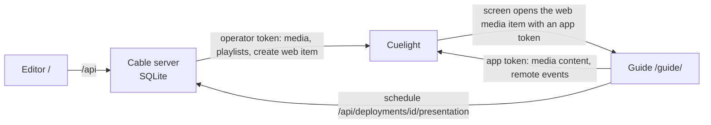

# Cuelight Cable

A cable-TV experience for Cuelight screens: author **deployments** (lineups) of
numbered **channels**, schedule **blocks** of Cuelight playlists or media on them, and show a
retro channel **guide** on any Cuelight screen. Pick a channel with the screen's remote and the
guide tunes to whatever is on air.

Cable owns only its schedule (SQLite). Media and playlists live in Cuelight: blocks store
Cuelight playlist and media ids, the Cable server reads their metadata through the Cuelight
operator API, and the guide plays media straight from Cuelight with the screen's app token.

Demo-ware built for the Mars College LAN: the Cable server has no login of its own. Keep it on a
trusted network.



## Setup

Requires Node 24 and pnpm.

```sh
pnpm install
pnpm build                     # editor + guide into dist/
CUELIGHT_URL=https://cuelight.example:8454 \
CUELIGHT_TOKEN=<operator token> \
CABLE_PUBLIC_URL=http://10.0.0.5:4190 HOST=0.0.0.0 \
pnpm start
```

Open `CABLE_PUBLIC_URL` (or `http://127.0.0.1:4190`) for the editor. The header badge shows
whether Cuelight is reachable and whether the token can write media.

Create the operator token in Cuelight with `media_read` (pickers, schedule metadata,
thumbnails) and, optionally, `media_write` (lets **Add to Cuelight** create the guide's web
media item).

### Environment

| Variable | Default | Purpose |
|---|---|---|
| `CUELIGHT_URL` | required | Cuelight origin, e.g. `https://cuelight.example.ts.net:8454`. |
| `CUELIGHT_TOKEN` | required | Cuelight operator token (`media_read`, optionally `media_write`). |
| `CUELIGHT_CA_FILE` | none | Extra CA certificate(s), PEM, trusted when calling Cuelight (self-signed control planes). |
| `CABLE_DB_PATH` | `data/cable.db` | SQLite database (created and migrated on start). |
| `CABLE_PUBLIC_URL` | `http://HOST:PORT` | Origin screens use to reach this server; guide URLs are built from it. |
| `PORT` | `4190` | Listen port. |
| `HOST` | `127.0.0.1` | Listen address. Use `0.0.0.0` so screens on the LAN can load the guide. |

## Authoring

- **Deployments**: name, timezone, theme (nebula, gallery, noir), guide slot size and horizon.
- **Channels**: number (unique per deployment), name, callsign, accent colour, enabled/standby.
- **Blocks**: a time window on a channel showing exactly one Cuelight **playlist** (its file
  items rotate in order for their durations; web items are skipped) or one Cuelight **media**
  item for the whole block. Blocks on a channel cannot overlap. Only `video/mp4`, JPEG, PNG and
  WebP media play in the guide; anything else is left off the schedule.
- **Programs**: standalone programme entries with metadata, kept for authoring (the guide plays
  blocks).

Edits reach screens within a minute: the guide re-reads the live schedule every 60 s.

## Putting the guide on a screen

Each deployment's page shows its **Guide URL**:
`${CABLE_PUBLIC_URL}/guide/?deployment=<deployment id>`.

1. Click **Add to Cuelight**. The server creates (or reuses) a Cuelight web media item for that
   URL, titled `Cable · <deployment>`, with *Cuelight app* access enabled. If the token lacks
   `media_write`, the page shows the URL instead: add it in Cuelight as a web item and turn on
   “Cuelight app — give this page access to the screen's remote and the media library”.
2. In Cuelight, assign that web media item to a screen.

The screen opens the guide with `#cuelight-token=…&cuelight-api=…` appended. The guide strips
the fragment, renews the app token before it expires, plays programmes from
`{cuelight-api}/app/media/{id}/content`, and follows the screen's remote via
`{cuelight-api}/app/remote/events`: arrows move through channels, Enter tunes, Channel Up/Down
and channel numbers tune directly, Guide/Back return to the guide, volume and mute work while
watching. If a phone remote session is active, its QR code appears on the guide.

Opened without a token (e.g. the **Preview** link in the editor), the guide renders the schedule
in preview mode with thumbnails proxied by the Cable server. The keyboard stands in for the
remote: arrows, Enter, Escape/Backspace, PageUp/PageDown for channel up/down, digits for a
channel number, `G` for the guide, `M` and `+`/`-` for audio.

## Importing pre-split Cable data

The control plane's old Cable tables, exported as `json_agg` rows (one JSON array per table),
import with their ids intact:

```sh
CABLE_DB_PATH=data/cable.db pnpm cable import /path/to/cable-export
```

Reads `cable_deployments.json` and `cable_channels.json` (required), `cable_blocks.json` and
`cable_program_entries.json` (optional), and `media.json` to map old asset ids to their file
media ids. Playlist ids are kept as Cuelight playlist references. Re-running updates rows in
place.

## Development

```sh
pnpm typecheck    # editor/guide (DOM) and server (Node) projects
pnpm test         # vitest: presentation builder, store, importer, HTTP API against a fake Cuelight, guide state/session
pnpm build
pnpm dev          # vite on :5173, proxying /api to PORT (run `pnpm start` alongside)
```

`src/server/testing/fakeCuelight.ts` is a tiny in-memory Cuelight (operator media/playlists,
web media creation, `/app/*`) used by the tests.

### Cuelight API contract

Types come from Cuelight's OpenAPI document, vendored at `vendor/cuelight-openapi.yaml` and
generated into `src/cuelight-api.d.ts` (`openapi-typescript` + `openapi-fetch`). Refresh both
from a Cuelight checkout or a running server:

```sh
pnpm sync:cuelight-api ../cable/api/openapi.yaml
pnpm sync:cuelight-api https://cuelight.example:8454/api/v1/openapi.yaml
pnpm sync:cuelight-api            # uses $CUELIGHT_URL/api/v1/openapi.yaml
```

### Layout

```
index.html, guide/index.html   Vite entries: editor (/) and guide (/guide/)
src/editor/                    editor UI (deployments → channels → blocks/programs)
src/guide/                     guide UI: presentation schema, runtime state, Cuelight app client, remote handling
src/server/                    Hono server: domain + validation, SQLite store, presentation builder, Cuelight client, importer, CLI
vendor/cuelight-openapi.yaml   pinned Cuelight contract
scripts/sync-cuelight-api.ts   contract refresh
```
